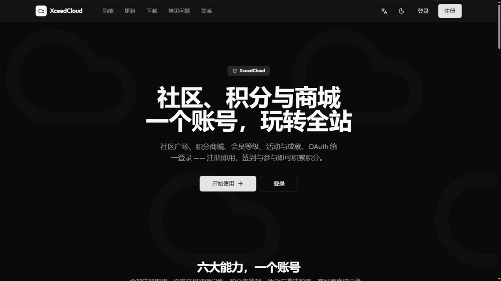
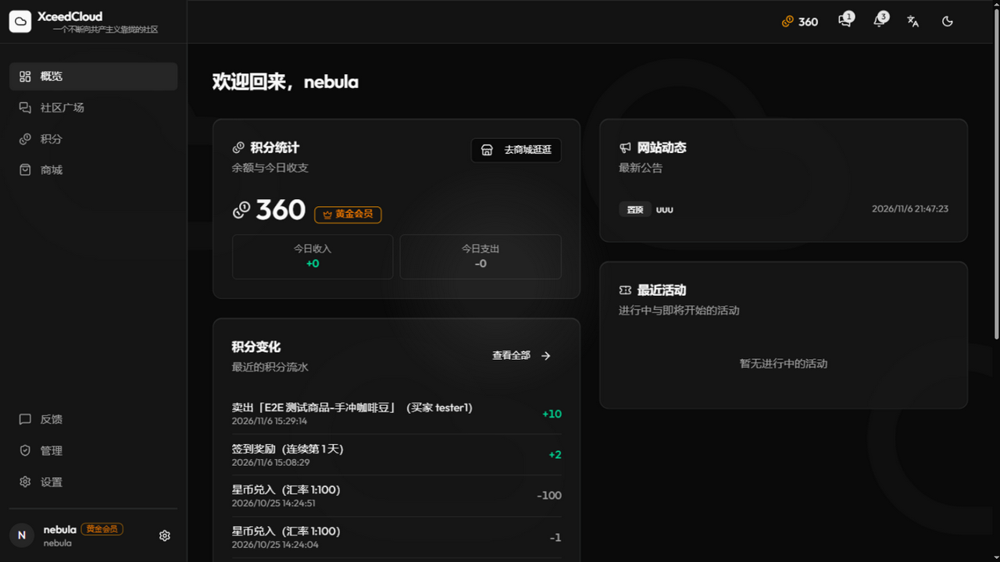
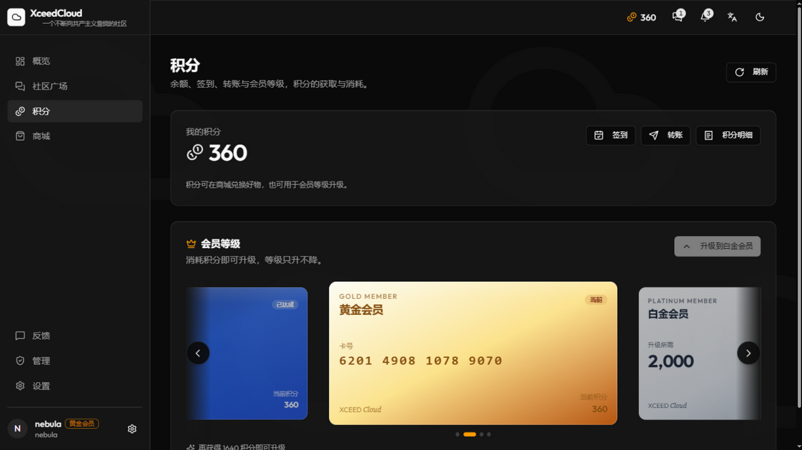
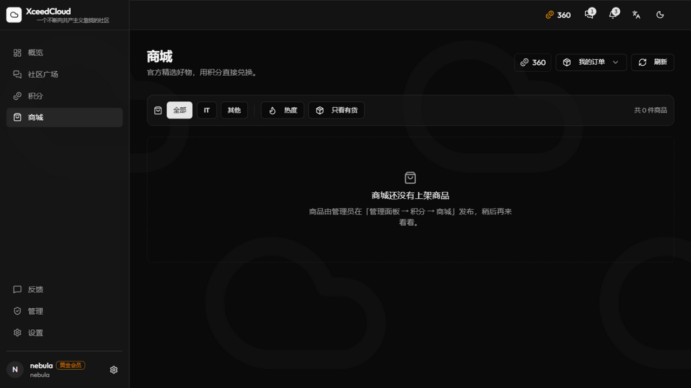
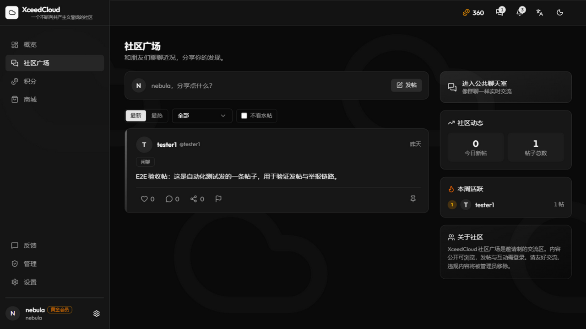
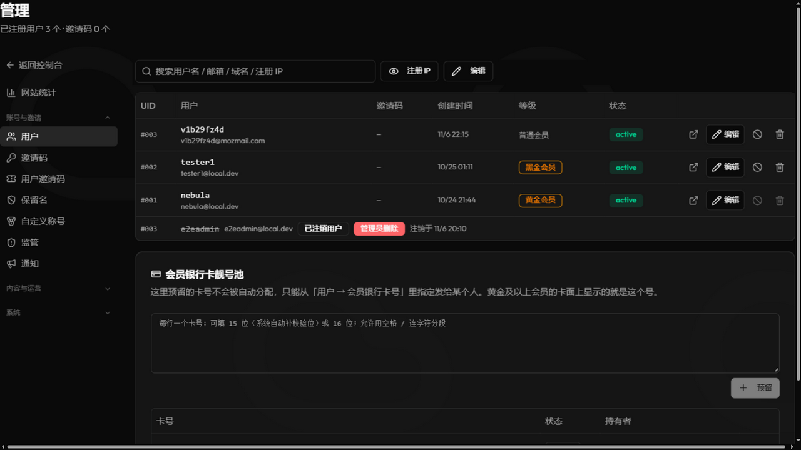

<div align="center">


# XceedCloud

**社区 · 积分商城 · 会员等级 · OAuth 开放登录 —— 一个账号，玩转全站**

纯静态前端 + Serverless 后端：前端是构建产物直出的 SPA，后端全部跑在 Cloudflare Workers 上，数据库用 D1（SQLite）、对象存储用 R2，不依赖任何常驻服务器。

[](worker/test)
[](worker/scripts)

</div>

---

## 界面预览

| 落地页 | 控制台概览 |
| :---: | :---: |
|  |  |
| **积分与会员银行卡** | **积分商城** |
|  |  |
| **社区广场** | **管理后台** |
|  |  |

---

## 功能概览

### 社区广场
- 发帖 / 评论 / 点赞，Markdown 正文，公开可浏览、登录后互动
- 举报队列：帖子 / 评论一键举报，后台「监管」处理（软删即下架）
- 邀请制注册，未登录访客只读

### 积分体系
- 签到（连续里程碑）、活动奖励、邀请奖励、管理员发放
- 积分转账（账号年龄 + 日限额双门槛）、全量流水明细
- 会员等级：普通 / 黄金 / 白金 / 黑金，消耗积分升级、**只升不降**，价格后台可配
- 会员「银行卡」：升到黄金即分配一张 16 位（Luhn 合法）卡号的银行卡，四套卡面轮播展示；后台可**预留靓号**并指定发放，号码终身不变

### 积分商城
- 仅管理员发布商品，交付方式：人工发放 / 邀请码额度 / 卡密 / 固定内容
- 商品详情页支持 Markdown + 受限 HTML（rehype-sanitize 白名单）
- 订单状态机：发货 → 确认收货，超时仲裁、售后（退款）流程
- 订单消息直达：买家 / 卖家在消息中心里直接「标记已交付 / 确认收货」

### 活动与成就
- 活动推广：口令 / GitHub Star / 投票 / 抽奖等奖励类型，服务端核验自动发放
- 成就系统与积分挂钩，授予记录可审计

### OAuth 2.0 开放登录
- 本站作为**身份提供方**：授权码 + PKCE，发现文档 / 机器端点齐全
- `openid / profile / email / points` 四种 scope，`points` 授权后第三方可查余额、经用户同意消耗积分
- 应用可设**会员等级门槛**，等级不足在同意页明确拦截
- 应用名防钓鱼（官方 / 客服 / 品牌词禁用），令牌全生命周期可撤销

### 通知与公告
- 站内消息中心四分类：系统 / 网站动态 / 社交 / 活动
- 公告支持**定时发布**、置顶、群发邮件（Brevo / SMTP 多通道分批 + 失败重发）
- 公告弹窗三种模式：不弹 / 弹一次（永久已读）/ 每次都弹；「不再显示」落服务端，换设备依然记住

### 管理后台
- 独立双入口 SPA（`/admin` 真路由），与用户端完全隔离
- 细粒度权限域（leaf key 白名单），管理员按域授权；全部写操作落审计日志
- 用户 / 邀请码 / 保留名 / 称号 / 监管 / 公告 / 活动 / 积分商城 / OAuth / 反馈 / CF 额度 / 性能监控 / 审计 / 设置 / 权限管理
- 默认邀请额度与「限时开放注册」联动：窗口开启期间自动暂停，关闭后恢复

### 其他
- PWA（可安装、离线壳）、深色模式、中英双语
- 服务自愈：dev 产物不被 SW 缓存、版本更新自动注销重建

---

## 架构

```
浏览器 ──► Cloudflare Workers（单 Worker 双入口）
            ├─ /            → 用户端 SPA（index.html，静态资源直出）
            ├─ /admin/*     → 管理后台 SPA（admin.html）
            ├─ /api/*       → REST API（handlers/ 按 tab 域拆分）
            └─ /oauth/*     → OAuth 2.0 授权服务器（IdP）
                    │
                    ├─ D1 (SQLite)   —— 全部业务数据，迁移按序号累积
                    ├─ R2            —— 头像 / 帖子图片 / 商品图
                    └─ Cron          —— 定时公告发布、活动开奖、邮件分批续跑、运维清理
```

## 技术栈

| 层 | 选型 |
| --- | --- |
| 前端 | React 19 · Vite 8 · Tailwind 4 · Radix UI · react-router 7 |
| 后端 | Cloudflare Workers · D1 · R2 · Durable Object（限流） |
| 质量 | TypeScript strict · vitest（950+ 用例）· 4 道静态护栏 · Playwright 真浏览器走查 |

四道护栏（`npm run check:guards`）：路由↔handler 一致性、设置项「假开关」检测、跨端 API 路径比对、未引用导出清点 —— 改动一旦破坏约定直接红灯。

## 目录结构

```
├─ index.html / admin.html     # 双入口 HTML
├─ src/                        # 用户端 + 管理后台（React）
│  ├─ pages/                   # 路由页（概览 / 积分 / 商城 / 社区 / 消息 / OAuth …）
│  ├─ admin/                   # 管理后台外壳
│  ├─ components/              # 通用组件（公告弹窗、银行卡轮播、富文本…）
│  ├─ layouts/                 # 仪表盘布局（侧边栏 / 顶栏 / 全站弹窗挂载点）
│  ├─ i18n/                    # 中英文案（zh / en）
│  └─ services/api.ts          # 全部 API 封装（与后端路由由护栏对账）
└─ worker/
   ├─ src/index.ts             # 路由表（225 条，静态护栏对账）
   ├─ src/handlers/            # 按业务域拆分的 handler
   ├─ src/settings.ts          # 66 个设置键的唯一权威源
   ├─ migrations/              # D1 迁移（按序号累积，0001 → 0176+）
   └─ test/                    # vitest 用例（95 文件 / 950+ 用例）
```

## 本地开发

```bash
# 1. 依赖
npm install && cd worker && npm install

# 2. 数据库（本地 D1）
npx wrangler d1 execute doulor-mail --local --file=./schema.sql
npx wrangler d1 migrations apply doulor-mail --local

# 3. 后端（必须 https：前端代理指向 https://127.0.0.1:8787）
cd worker && npm run dev -- --local-protocol https

# 4. 前端（另开终端）
npm run dev            # http://localhost:5173

# 5. 质量检查
cd worker && npm run check:guards && npx vitest run
npm run check:i18n
```

管理员账号：本地 D1 里把任意用户 `role` 设为 `root` 即可；后台入口 `/admin`。

## 部署（Cloudflare）

```bash
npx wrangler d1 migrations apply doulor-mail --remote
cd worker && npm run deploy
npm run build && npx wrangler pages deploy dist   # 或 Workers 静态资产直出
```

`worker/wrangler.toml` 中的环境变量与 secrets（`SESSION_SECRET`、`CLOUDFLARE_API_TOKEN`、邮件通道密钥等）见 `worker/.dev.vars.example`。

---

## 致谢与许可

基于 [Doulor/DoulorCloud](https://github.com/Doulor/DoulorCloud) 二次开发，按自身场景裁剪为社区 + 积分商城 + OAuth 的形态，并在此基础上持续演进（会员等级与银行卡、靓号池、举报监管、公告定时发布等）。

[MIT](LICENSE) © XceedCloud

第三方资源遵循各自许可（如自托管的 Outfit 字体为 SIL OFL、图标为 lucide 的 ISC）。
